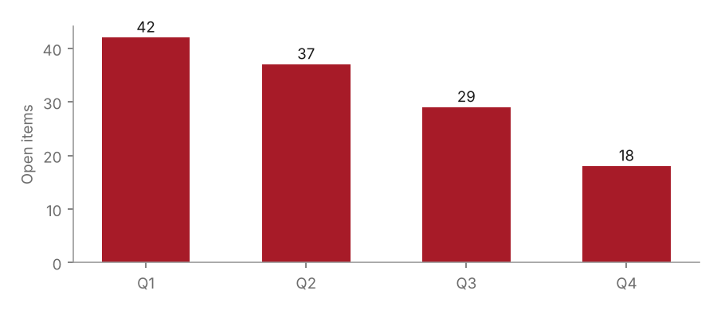

<!-- A working document: no status, version history, or review cycle. Those
     belong only on controlled documents that go through approval. -->

# Summary

Incoming rejects fell from 2.4% to 1.6% quarter over quarter. Two suppliers
account for most of what remains. Recommended: a corrective action request for
each, and a re-audit of one before Q1.

# Findings

| Supplier | Lots received | Rejected | Reject rate | Trend |
|---|--:|--:|--:|---|
| Supplier A | 412 | 3 | 0.7% | Improving |
| Supplier B | 198 | 9 | 4.5% | Worse |
| Supplier C | 260 | 6 | 2.3% | Flat |

{width=60%}

# Recommendations

- Issue corrective action requests to Supplier B and Supplier C.
- Re-audit Supplier B's final inspection before the Q1 build.

> [!NOTE]
> Figures cover lots received July 1 through September 30.
