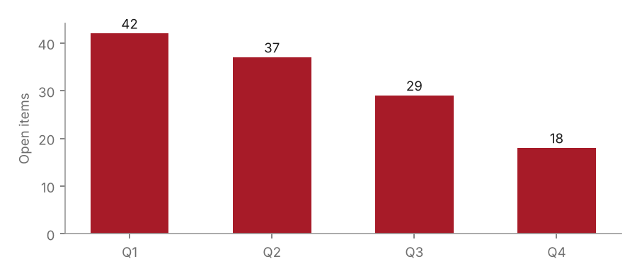
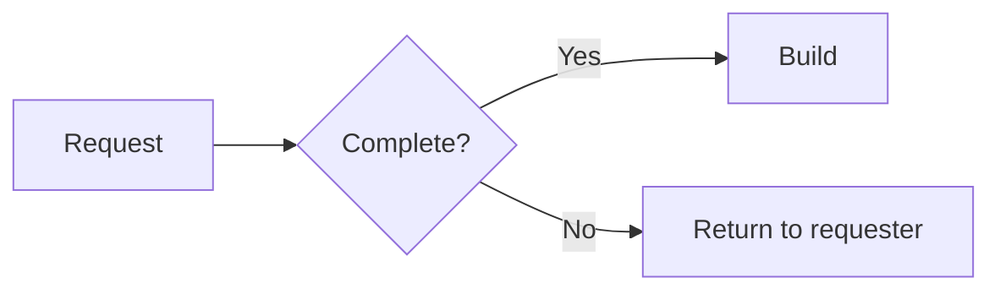

<!-- Comments like this one are dropped from every format. -->

# Purpose

This fixture exists so that every builder can be rebuilt after any parser change
and compared against known-good output. It is deliberately hard-wrapped across
several source lines so that a builder which treats each line as its own
paragraph is caught immediately. The whole block must render as one paragraph
with one space between joined lines.

A second paragraph confirms that a blank line, and only a blank line, starts a
new paragraph.

# Scope

## Inline formatting

Plain text, then **bold**, then *italic with an asterisk*, then _italic with an
underscore_, then `inline code`, then a **bold phrase containing `code`**, then a
[link to the company site](https://soundoffsignal.com/), then an escaped
asterisk \* that must survive as a literal, then an escaped pipe in prose a \| b.

## Bullets, including nesting

- First level bullet with **bold** and `code`
- Second first-level bullet
    - Nested bullet one
    - Nested bullet two
        - Third level bullet
- Third first-level bullet

## Ordered steps

1. Confirm the request is complete.
2. Gather the source records.
    1. Filter to the affected period.
    2. Export the working set.
3. Record the outcome in the tracker.

## Mixed nesting

1. Ordered step with a nested bullet list
    - Supporting detail
    - Another supporting detail
2. Ordered step with a nested fenced code block

    ```
    show running-config | match tunnel
    ```

## Fenced code

```python
def classify(level):
    return {"PUBLIC": "PUBLIC"}.get(level, "INTERNAL USE ONLY")
```

## Blockquote

> Production downtime carries direct revenue consequences. Weigh manufacturing
> continuity alongside other risk before changing a production system.

## Callouts

> [!NOTE]
> A note callout with **bold** text that wraps across more than one source line
> and must render as one paragraph.

> [!WARNING] Custom warning title
> A warning with a list:
>
> - first item
> - second item

> [!CAUTION]
> Caution text.

## Table with alignment

| Item | Owner | Severity | Status |
|---|:---:|:---:|---:|
| Baseline review | Document Owner | High | Open |
| Segmentation review | Operations | Critical | In Progress |
| Quarterly access review | Department Managers | Medium | Closed |

<!-- pagebreak -->

# Figures

## Image with caption and width

{width=70%}

## Mermaid diagram



## Thematic break

---

# Policy Statement

The paragraph after a thematic break must still render as body text, and this H1
must produce a real Heading 1 style in Word and a section divider in the deck
rather than being silently dropped.

## Roles & Responsibilities

| Role | Responsibility |
|---|---|
| Executive Sponsor | Approves the document and resolves cross-functional conflict. |
| Document Owner | Maintains the document, reviews exceptions, and reports status. |
| Department Managers | Ensure their teams follow this document. |

???

Speaker notes for the deck: this text must appear in the notes pane only.

## Review Cycle

Reviewed annually, or upon a material change to the environment, a significant
incident, or a change in contractual obligation.
